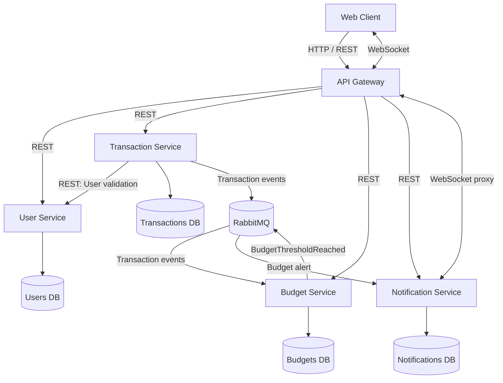

# 02 — Architecture

## Overview

SpendWise is organized into four microservices, a web client, an API Gateway, and RabbitMQ.

Each microservice handles a specific part of the application and has its own database.

## Service Responsibilities

| Component | Responsibility |
| --- | --- |
| Web Client | Interface for managing transactions, budgets, and notifications |
| API Gateway | Routes requests and WebSocket connections |
| User Service | Manages accounts, login, and user profiles |
| Transaction Service | Manages income, expenses, and categories |
| Budget Service | Manages monthly budgets and spending totals |
| Notification Service | Stores notifications and delivers alerts |
| RabbitMQ | Transfers events between microservices |

## Architecture Diagram

