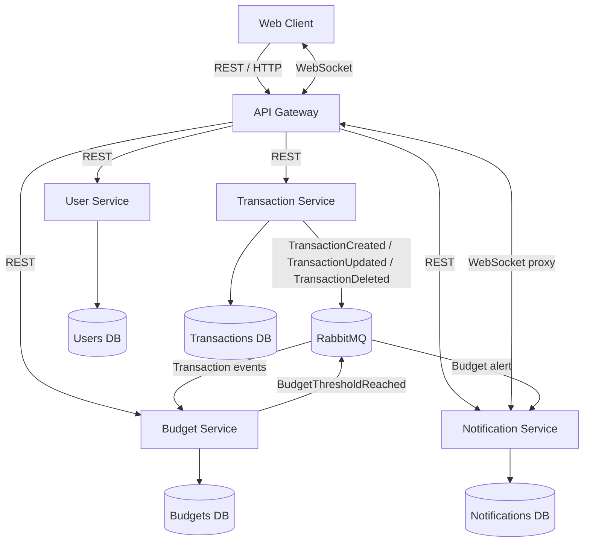

# 02 — Architecture

## Overview

SpendWise is a microservice-based web application for managing personal income, expenses, and budgets.

The system consists of four microservices, a web client, an API Gateway, and RabbitMQ.

- **REST API** handles requests between the client and services.
- **RabbitMQ** handles asynchronous communication between services.
- **WebSocket** sends real-time notifications to the client.
- **API Gateway** provides a single entry point for the web client.

Each microservice manages its own data.

## Service Responsibilities

| Component | Responsibility |
| --- | --- |
| Web Client | User interface for managing transactions, budgets, and notifications |
| API Gateway | Routes HTTP requests and WebSocket connections |
| User Service | User registration, login, authentication, and profiles |
| Transaction Service | Manages income, expenses, and transaction categories |
| Budget Service | Manages monthly budgets and calculates spending totals |
| Notification Service | Stores notifications and delivers real-time alerts |
| RabbitMQ | Transfers asynchronous events between services |

## Architecture Diagram

## Communication Flow

When a user adds an expense:

1. The web client sends the expense details through the API Gateway.
2. The Transaction Service saves the expense in its database.
3. The Transaction Service publishes a `TransactionCreated` event to RabbitMQ.
4. The Budget Service receives the event and updates the spending total.
5. If the spending reaches or exceeds the budget limit, the Budget Service publishes a `BudgetThresholdReached` event.
6. The Notification Service receives the event and saves a notification.
7. The notification is sent to the web client through WebSocket.

## Data Management

Each microservice manages its own database:

- **User Service:** User accounts and profiles.
- **Transaction Service:** Income, expenses, and categories.
- **Budget Service:** Budget limits and spending totals.
- **Notification Service:** Notifications and their read status.

Services exchange information through REST APIs or RabbitMQ instead of directly accessing another service's database.

Budget totals are updated after the Budget Service processes transaction events.
