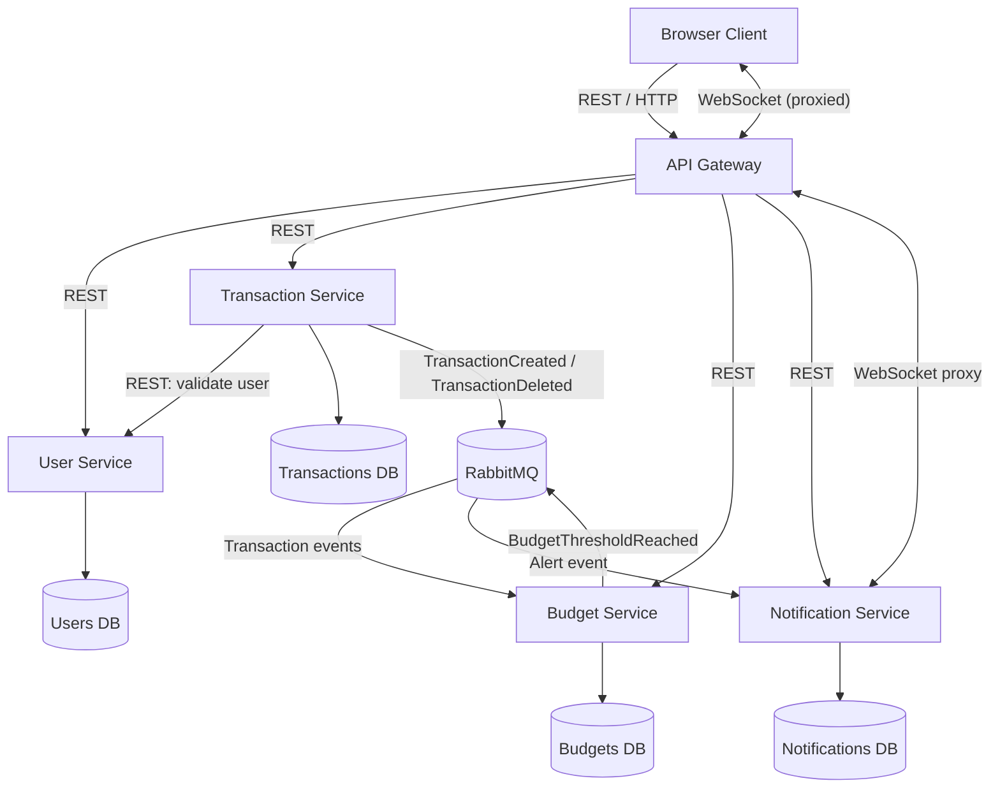

# 02 — Architecture

## Service responsibilities
| Component | Responsibility | Owns data? |
| --- | --- | --- |
| Web Client | User interface, HTTP calls, WebSocket connection | No |
| API Gateway | Single public entry point; REST routing, WebSocket proxy | No |
| User Service | User profiles and authentication | Yes |
| Transaction Service | Income/expense records and categories | Yes |
| Budget Service | Monthly budget limits and spending totals | Yes |
| Notification Service | Warning records and live alert delivery | Yes |
| RabbitMQ | Delivers asynchronous events | Broker infrastructure |

Each microservice owns its data. The API Gateway routes requests and is separate from the four business services.

## Architecture diagram

## Service boundaries
- Services do not read each other's databases directly.
- Transaction Service owns transactions; Budget Service owns budget limits and derived spending totals.
- Notifications are delivered on a best-effort basis; the stored notification list allows users to see missed alerts later.
- Budget totals are **eventually consistent**: they may update shortly after the transaction response.
- The WebSocket is opened by the browser at the Gateway; the Gateway proxies it to Notification Service.
