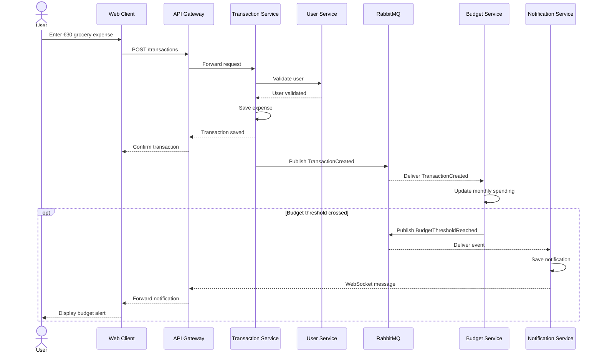

# 03 — Communication

## Communication Styles

SpendWise uses three communication methods:

- **REST:** Handles requests from the web client through the API Gateway and allows the Transaction Service to validate users through the User Service.
- **RabbitMQ:** Transfers transaction and budget events between microservices asynchronously.
- **WebSocket:** Delivers real-time budget notifications to the web client through the API Gateway.

## Add Expense Sequence

The diagram shows how an expense is saved, processed by the Budget Service, and may trigger a notification.

## Events

RabbitMQ is used to exchange the following events:

| Event | Publisher | Consumer | Purpose |
| --- | --- | --- | --- |
| TransactionCreated | Transaction Service | Budget Service | Add an expense to spending totals |
| TransactionUpdated | Transaction Service | Budget Service | Adjust spending totals after a transaction changes |
| TransactionDeleted | Transaction Service | Budget Service | Remove a deleted expense from spending totals |
| BudgetThresholdReached | Budget Service | Notification Service | Create a budget notification |

Income transactions do not increase expense-based budget totals.

## Event Data

Each event includes an `event_id` to identify the message.

### TransactionCreated

- event_id
- transaction_id
- user_id
- category_id
- type
- amount_cents
- occurred_at

### TransactionUpdated

- event_id
- transaction_id
- user_id
- old_category_id
- new_category_id
- old_type
- new_type
- old_amount_cents
- new_amount_cents
- old_occurred_at
- new_occurred_at

### TransactionDeleted

- event_id
- transaction_id
- user_id
- category_id
- type
- amount_cents
- occurred_at

### BudgetThresholdReached

- event_id
- budget_id
- user_id
- month
- threshold
- spent_cents
- limit_cents

All monetary values are stored in integer cents, and the application uses EUR.

## Error Handling

- REST requests return an appropriate response when an operation fails.
- RabbitMQ messages are acknowledged only after successful processing. Failed messages can be retried.
- Event IDs help prevent the same event from being processed more than once.
- If the WebSocket connection is lost, the client can reconnect and retrieve saved notifications through REST.
- Budget totals may take a short time to update because transaction events are processed asynchronously.

## Budget Thresholds

SpendWise generates notifications when spending reaches the following thresholds:

| Threshold | Notification |
| --- | --- |
| 80% | Warning that the budget is almost reached |
| 100% | Alert that the budget limit has been reached or exceeded |

Notifications are generated when spending crosses a threshold, rather than for every transaction while spending remains above it.
