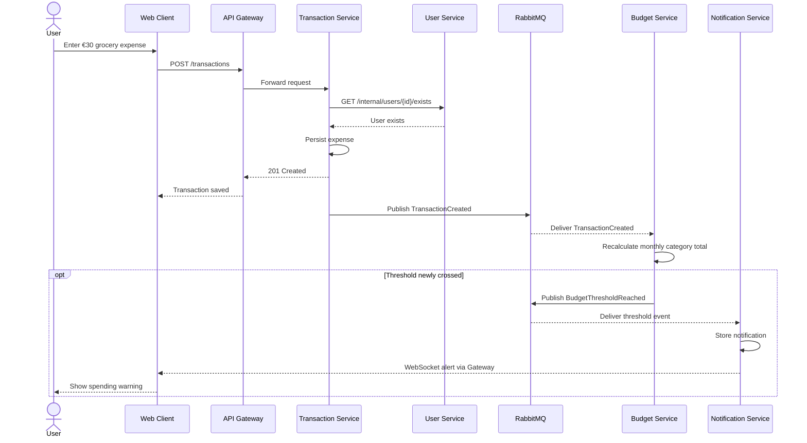

# 03 — Communication

## Communication styles
- **Synchronous REST:** Browser → Gateway → services. Transaction Service → User Service to validate that an account exists (for the initial simplified design).
- **Asynchronous events:** Transaction Service publishes events to RabbitMQ. Budget Service consumes them and publishes a threshold event when appropriate. Notification Service consumes threshold events.
- **Real time:** Notification Service pushes an alert over a WebSocket proxied through the Gateway to the browser.

## Add expense sequence

## Events
`TransactionCreated`: `event_id`, `transaction_id`, `user_id`, `category_id`, `amount`, `currency`, `occurred_at`.

`TransactionDeleted`: `event_id`, `transaction_id`, `user_id`, `category_id`, `amount`, `currency`, `occurred_at`.

`BudgetThresholdReached`: `event_id`, `budget_id`, `user_id`, `period`, `threshold`, `spent`, `limit`.

## Reliability and consistency
- RabbitMQ consumers will acknowledge events after successful processing.
- Consumers will track event IDs to avoid double-counting when events are redelivered.
- A threshold alert is created only when crossing into a new threshold band (e.g., below 80% → 80%+, or below 100% → 100%+).
- Publishing an event after saving a transaction leaves a failure window. A transactional outbox can address this.
- Browser dashboards may refresh totals via REST after a transaction; WebSocket alerts are a separate real-time feature.
