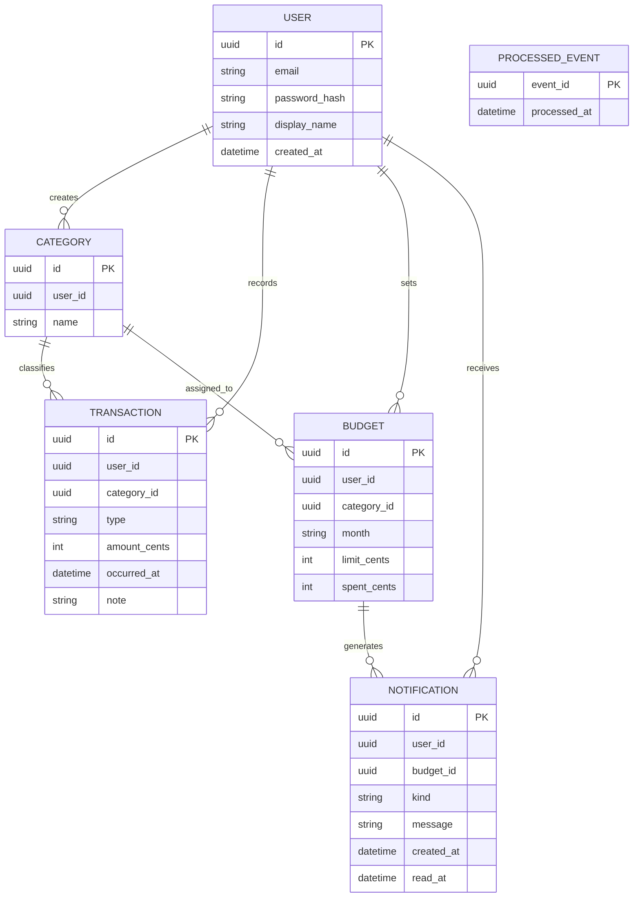

# 04 — Data Model

## Database Structure

SpendWise has four microservices, each with its own database.

- **User Service:** Stores user accounts and login information.
- **Transaction Service:** Stores income, expenses, and categories.
- **Budget Service:** Stores monthly budgets and spending totals.
- **Notification Service:** Stores budget notifications.

Each service manages its own data. Services communicate through REST APIs and RabbitMQ instead of accessing another service's database directly.

## Entities

| Service | Entity | Main Fields |
|---|---|---|
| User Service | User | id, email, password_hash, display_name, created_at |
| Transaction Service | Transaction | id, user_id, category_id, type, amount_cents, occurred_at, note |
| Transaction Service | Category | id, user_id, name |
| Budget Service | Budget | id, user_id, category_id, month, limit_cents, spent_cents |
| Budget Service | ProcessedEvent | event_id, processed_at |
| Notification Service | Notification | id, user_id, budget_id, kind, message, created_at, read_at |

## Entity Relationship Diagram

The diagram shows the main entities used in SpendWise and their relationships.

## Data Relationships

### User and Transactions
Each user can create multiple transactions. Every transaction belongs to one user.

### Categories and Transactions
Each transaction belongs to a category. Categories help organize income and expenses, such as groceries, transport, and salary.

### Categories and Budgets
Users can create monthly budgets for their expense categories. Each budget contains a spending limit and the current spending total.

### Budgets and Notifications
When spending reaches 80% or 100% of a budget limit, the Budget Service sends an event to the Notification Service.

The Notification Service saves the notification and sends it to the user through WebSocket.

### Processed Events
The Budget Service stores processed event IDs to prevent the same transaction event from being counted more than once.

## Data Storage Rules

- Each microservice has its own database.
- Services cannot directly access another service's database.
- IDs can be shared between services, but there are no foreign key constraints between different databases.
- Monetary amounts are stored as integer cents to avoid rounding errors.
- SpendWise uses EUR as its currency.
- Transaction amounts are stored as positive values. The `type` field identifies income or expense.
- Spending totals are updated when the Budget Service receives transaction events from RabbitMQ.
- Notifications remain stored so users can view them later.

## Example

A user creates a monthly grocery budget of €300.

The Budget Service stores:

| Field | Value |
|---|---|
| user_id | User's ID |
| category_id | Grocery category ID |
| month | 2026-11 |
| limit_cents | 30000 |
| spent_cents | 0 |

When the user adds a €30 grocery expense:

1. The Transaction Service saves the transaction with `amount_cents = 3000`.
2. It publishes a `TransactionCreated` event.
3. The Budget Service receives the event.
4. The spending total increases from €0 to €30.
5. If spending reaches 80% or 100% of the budget, a notification event is published.
6. The Notification Service saves the notification and sends it to the web client.
