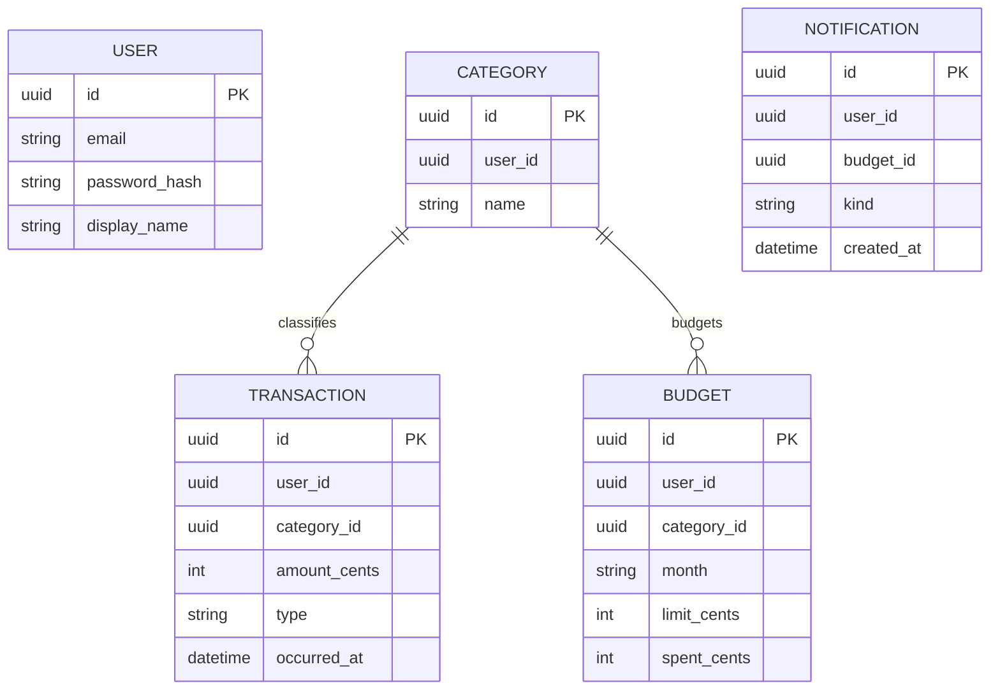

# 04 — Data model

Each microservice owns its own database. Identifiers may be referenced across services, but **no cross-database foreign keys** are used.

| Service | Entity | Main fields |
| --- | --- | --- |
| User | User | id, email, password_hash, display_name, created_at |
| Transaction | Transaction | id, user_id, category_id, type, amount, currency, occurred_at, note |
| Transaction | Category | id, user_id, name |
| Budget | Budget | id, user_id, category_id, month, currency, limit_amount, spent_amount |
| Budget | ProcessedEvent | event_id, processed_at |
| Notification | Notification | id, user_id, budget_id, kind, message, created_at, read_at |

The application uses EUR only, so currency conversion is not needed. Amounts are stored as integer cents (or an exact decimal), never binary floating-point values.

## Entity ownership diagram

The diagram shows conceptual relationships, not cross-service database joins. User IDs and category IDs are checked through service APIs or trusted events when necessary.
