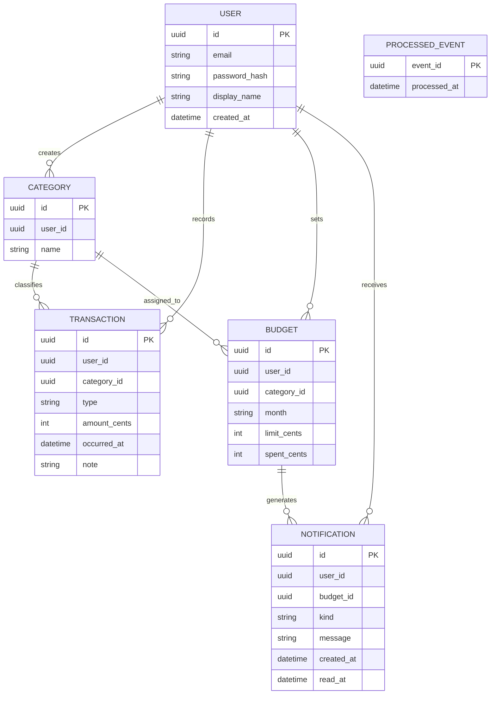

# 04 — Data Model

## Database Structure

Each SpendWise microservice has its own database and manages its own data.

## Entities

| Service | Entity | Main Fields |
| --- | --- | --- |
| User Service | User | id, email, password_hash, display_name, created_at |
| Transaction Service | Transaction | id, user_id, category_id, type, amount_cents, occurred_at, note |
| Transaction Service | Category | id, user_id, name |
| Budget Service | Budget | id, user_id, category_id, month, limit_cents, spent_cents |
| Budget Service | ProcessedEvent | event_id, processed_at |
| Notification Service | Notification | id, user_id, budget_id, kind, message, created_at, read_at |

## Entity Relationship Diagram

The diagram shows the main entities and their logical relationships.

## Data Storage Rules

- Each service manages its own database.
- Relationships between entities in different services are logical references, not database foreign keys.
- Monetary amounts are stored as integer cents, and EUR is the only supported currency.
- Transaction amounts are positive. The `type` field identifies income or expense.
- Budget spending totals are updated from transaction events.
- The `ProcessedEvent` entity stores event IDs to prevent duplicate processing.
- Notifications are stored so users can view them later.

## Data Constraints

- User email addresses must be unique.
- Each category belongs to one user.
- Each transaction must have a valid type (`income` or `expense`) and an amount greater than zero.
- Each budget is associated with one user, one category, and one month.
- A user can have only one budget per category per month.
- Budget limits must be greater than zero.
